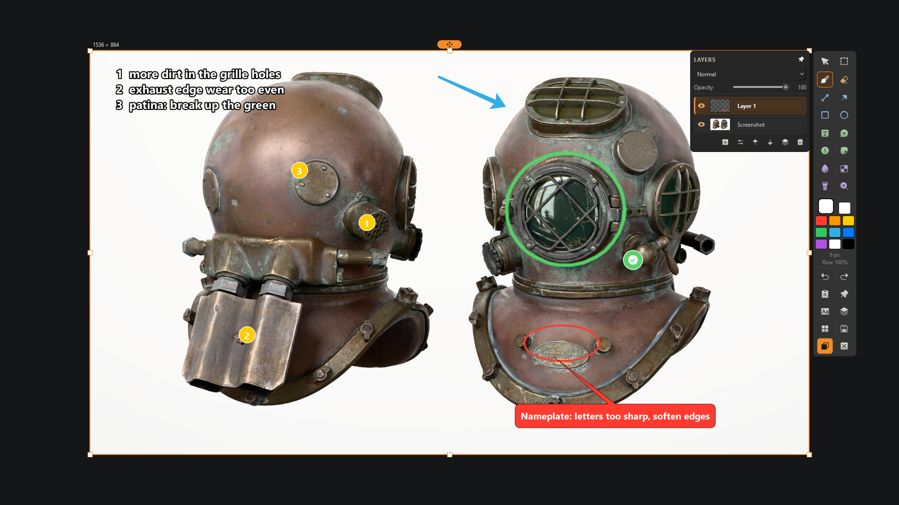
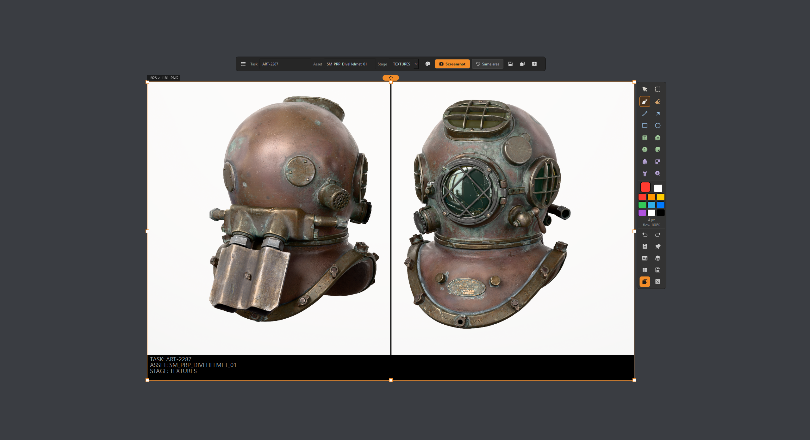
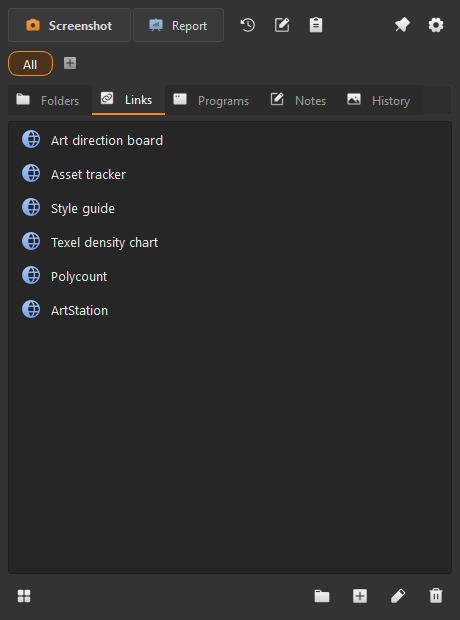
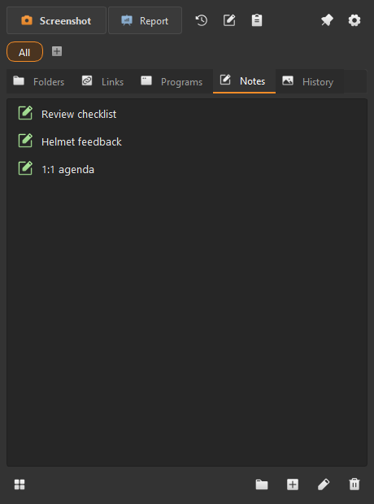

# Lead Tool

A small Windows tray utility that cuts routine tasks:
- screenshot of one monitor with drawing right on top;
- report images: screenshots in a row with a task number and asset name;
- folders, links, programs and notes one hotkey away.

It never goes online.
For a security review, see [SECURITY.md](SECURITY.md).



## Features

**Capture and annotate**
- Captures the monitor under the cursor; the other monitors stay live.
- Drag an area, click a window, R = the last area, Enter = the whole screen.
- Tools:
  - drawing: brush with Substance Painter-like brushes, flow and angle; eraser; line; arrow; rectangle; ellipse;
  - text: text, callout bubble;
  - marking: numbered markers, stamps (check, cross, !, ?, star);
  - hiding and pointing: blur, pixelate, spotlight, magnifier.
- Editing:
  - select (W) to move, rotate, scale, distort, flip or warp marks;
  - lasso and rectangle selection;
  - Photoshop-like layers with opacity, blend modes and adjustment layers (Levels, Brightness/Contrast, Hue/Saturation);
  - undo/redo.
- Copy, save, pin on screen, or copy the text in the picture (Windows' built-in OCR, offline).
- History of the last 60 screenshots; reopen one with its marks still editable.

**Report**



- A floating window that collects screenshots in a row, at their full resolution.
- A band at the bottom shows Task / Asset / Stage, typed by hand.
- Optional logo of your own: double-click its place.
- Save as a PNG named after the task number, or copy it.
- Recent reports bring back their Task / Asset.

**Launcher panel**

| Links | Notes |
|---|---|
|  |  |

- Folders, links, programs and quick notes, grouped by filter chips; list or tile view; colour labels.
- Links open in the default browser or in one you add (with its profile).
- Running-program picker, drag and drop, Ctrl+V to add.
- Clipboard history, memory only.

## Hotkeys (all can be changed in Settings > Keys, any keyboard layout)

| Where | Key | Action |
|---|---|---|
| Anywhere | Ctrl+Shift+S | Screenshot |
| Anywhere | Ctrl+Alt+S | The same area again |
| Anywhere | Ctrl+Alt+L | Launcher panel |
| Anywhere | Ctrl+Alt+N | Quick note |
| Editor | W P X L A R E T N B M | Select, brush, eraser, line, arrow, rectangle, ellipse, text, number, blur, pixelate |
| Editor | K S F Z O | Callout, stamp, spotlight, magnifier, lasso |
| Editor | Q / Tab | Brush list / pie menu |
| Editor | Space + drag / Ctrl + drag | Brush size / flow and angle |
| Editor | Right click or C / Alt + click | Palette / eyedropper |
| Editor | Shift + click | Straight line from the last stroke |
| Editor | F7 / U | Layers / warp the selection |
| Editor | Ctrl+Z, Ctrl+Shift+Z | Undo, redo |
| Editor | Enter or Ctrl+C / Ctrl+S / Ctrl+P / Ctrl+T | Copy and close / save / pin / OCR |
| Report | Shift or Alt + wheel, middle drag, Ctrl+R | Zoom, pan, reset view |

## Install

Download `LeadTool-<version>.zip` from [Releases](../../releases), unzip anywhere, and run `LeadTool\LeadTool.exe`.
- Nothing is installed and no admin rights are needed.
- Settings and notes live in `%APPDATA%\LeadTool`.
- To remove it, delete the folder; `%APPDATA%\LeadTool` holds the settings.

## Build from source

```
python -m venv .venv
.venv\Scripts\pip install -r requirements.txt
.venv\Scripts\python -m leadtool          # run from source
.venv\Scripts\python build.py            # dist\LeadTool-<version>.zip + dist\LeadToolSetup.exe
```

Python 3.10, PySide6 (Qt), numpy, winrt (Windows OCR), PyInstaller.
Icons: [Phosphor Icons](https://phosphoricons.com) (MIT, see `leadtool/icons/LICENSE_phosphor`).
